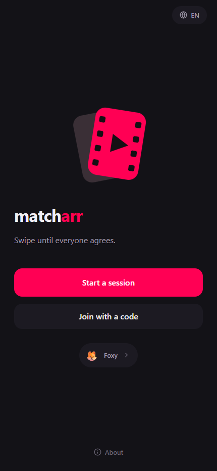
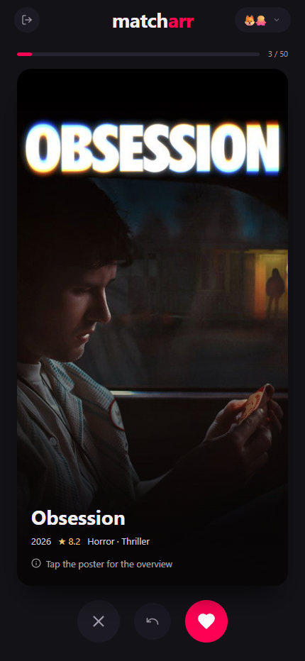
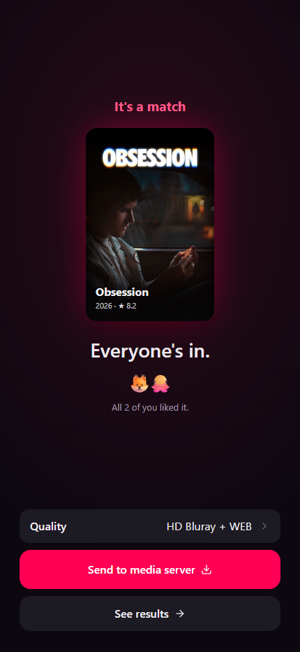

# matcharr

[](https://github.com/Jagerente/matcharr/actions/workflows/ci.yml)

Group movie picking for a home media server. One person starts a session,
everyone else joins from their phone by scanning a QR code, and the whole
group swipes through the same deck. A film that everyone likes is a match,
and the host can send it to Seerr for download right from the results
screen.

<p align="center">
  
  
  
</p>

## How it works

1. The host picks a preset ("Popular now"), a match rule and a deck size,
   then gets a short join code with a link and a QR.
2. Others scan it, fills short identity.
3. The lobby fills up. The host can still change filters or remove
   someone, then presses Start.
4. Everyone gets the same deck in the same order and swipes at their own
   pace. Tapping a card opens the overview, rating, genres and runtime.
   A mis-swipe can be undone.
5. When a movie collects a like from every participant, every phone in the
   room shows the match at the same moment.
6. If the deck runs out first, the results screen lists near-matches
   (liked by all but one) and the host can propose more movies or finish it.

## Features

**Sessions.** Join by link or QR with a name and an optional emoji avatar,
no accounts anywhere. Identity is a token in localStorage, so a page
reload or a locked phone never drops a participant. Two people minimum.
The host can kick someone, finish early, or cancel the session while still
in the lobby, and matches are recomputed over whoever is left. Session
lifetimes are configurable through `MATCHARR__SESSION__*`: a session
nobody is connected to is retired after a grace period, results of a
finished session stay readable a while longer, and every session has an
outer ceiling regardless of activity.

**Decks.** Six built-in TMDB presets (trending this week, popular now,
all-time popular, top rated, new releases, now in theaters) and a custom
one assembled from filters alone. Filters apply on top of any preset:
genres, year range, minimum rating, minimum vote count. The deck size is
chosen at creation, up to the configured ceiling. Your own presets live
in `presets.yml` and can add, replace or hide the built-ins.

**Matching.** Unanimous by default, or "X of N" for groups where nobody
ever agrees on everything. Three completion modes: stop at the first
match, stop after N matches, or run the whole deck and show every match at
the end. Other people's votes stay hidden until a match fires, so the room
cannot be played. When the deck ends without a result, near-matches are
sorted by like count and shown with per-participant stats.

**After the match.** With `MATCHARR__SEERR__URL` configured, the host gets
a Request button and a Radarr quality profile picker for any movie in the
deck. Leave it empty and the button disappears, leaving matcharr as a
picker.

**How it's built.** A single image, no database, since sessions
are ephemeral by nature and live in memory.
Posters are served through a disk-cached proxy, so phones never talk to
TMDB directly. The lobby, votes and matches arrive over a WebSocket. A
base path such as `/matcharr` is supported, so the app fits on a shared
reverse proxy port instead of claiming its own.

## Quick start

```bash
docker run -d --name matcharr -p 8585:8585 \
  -e MATCHARR__TMDB__APIKEY=<TMDB v3 key> \
  -v "$PWD/config:/config" \
  ghcr.io/jagerente/matcharr:latest
```

Images are published to GitHub Container Registry for `linux/amd64` and
`linux/arm64`. Pick `latest` or a pinned `1.0.0`, `1.0`, `1` for releases,
or `edge` to track the `main` branch. Building from source works too:
`docker build -t matcharr .`.

Open `http://localhost:8585` (8585 is the default `MATCHARR__SERVER__PORT`).
For friends to reach it from their phones, publish it on the LAN address
of the host or over Tailscale, and everything in the UI keeps working over
plain HTTP.

### docker compose

```yaml
services:
  matcharr:
    image: ghcr.io/jagerente/matcharr:latest
    container_name: matcharr
    environment:
      - TZ=${TZ:-Asia/Bangkok}
      - MATCHARR__TMDB__APIKEY=${MATCHARR_TMDB_API_KEY}
      - MATCHARR__SERVER__URLBASE=/matcharr
      - MATCHARR__SEERR__URL=http://seerr:5055
      - MATCHARR__SEERR__APIKEY=${SEERR_API_KEY}
    volumes:
      - ./config/matcharr:/config
    ports:
      - "8585:8585"
    restart: unless-stopped
```

The image ships a healthcheck against `/healthz`, so `docker compose ps`
reports the service as healthy once it can serve traffic.

### Behind a reverse proxy

Set `MATCHARR__SERVER__URLBASE` to the path you route, then hand the whole
subtree to the container. For Caddy:

```caddyfile
handle /matcharr* {
	reverse_proxy matcharr:8585 {
		header_up X-Real-IP {remote_host}
	}
}
```

WebSocket upgrades pass through with no extra configuration. `/healthz`
stays at the root, outside the base path, so container health checks do
not depend on proxy settings.

### When TMDB is blocked

Some ISPs block TMDB, and a VPN on the host usually does not cover Docker's
NAT traffic. Three settings cover that, in increasing order of effort:

- `MATCHARR__TMDB__BASEURL` and `MATCHARR__TMDB__IMAGEBASEURL` point at a
  mirror or a proxy of your choice.
- `HTTPS_PROXY`, `HTTP_PROXY` and `NO_PROXY` are honored by the Go HTTP
  client, so the standard variables work as expected.
- `extra_hosts: ["api.themoviedb.org:18.65.82.74"]` in compose pins the
  address when DNS is the part being tampered with.

Participants never need any of this: their phones only talk to matcharr,
which fetches metadata and posters on their behalf.

## Configuration

| Variable                             | Purpose                                          | Default                          |
|--------------------------------------|--------------------------------------------------|----------------------------------|
| `MATCHARR__TMDB__APIKEY`             | TMDB API v3 key (required)                       | none                             |
| `MATCHARR__SERVER__PORT`             | HTTP port                                        | `8585`                           |
| `MATCHARR__SERVER__URLBASE`          | base path behind a proxy (`/matcharr`)           | empty                            |
| `MATCHARR__SERVER__READTIMEOUT`      | deadline for reading a request (`0` disables)    | `30s`                            |
| `MATCHARR__SERVER__READHEADERTIMEOUT`| deadline for the request headers alone           | `10s`                            |
| `MATCHARR__SERVER__IDLETIMEOUT`      | how long an idle keep-alive connection is kept   | `2m`                             |
| `MATCHARR__CONFIG__DIR`              | directory for presets.yml and caches             | `./config` (`/config` in Docker) |
| `MATCHARR__TMDB__BASEURL`            | TMDB API mirror or proxy (without `/3`)          | `https://api.themoviedb.org`     |
| `MATCHARR__TMDB__IMAGEBASEURL`       | image CDN (including `/t/p`)                     | `https://image.tmdb.org/t/p`     |
| `MATCHARR__TMDB__LANGUAGE`           | metadata language                                | `en-US`                          |
| `MATCHARR__TMDB__CACHETTL`           | TMDB response cache TTL                          | `30m`                            |
| `MATCHARR__IMAGE__CACHESIZEMB`       | poster cache size cap in MB (`0` for no limit)   | `512`                            |
| `MATCHARR__IMAGE__MAXFILEMB`         | ceiling on one poster download, MB               | `4`                              |
| `MATCHARR__SEERR__URL`               | Seerr address, empty hides the Request button    | empty                            |
| `MATCHARR__SEERR__APIKEY`            | Seerr API key                                    | none                             |
| `MATCHARR__SESSION__TTL`             | outer ceiling on any session                     | `24h`                            |
| `MATCHARR__SESSION__EMPTYGRACE`      | lifetime with nobody connected or calling        | `15m`                            |
| `MATCHARR__SESSION__FINISHEDTTL`     | how long results stay fetchable                  | `1h`                             |
| `MATCHARR__LIMITS__SESSIONS`         | ceiling on live sessions (`0` for none)          | `0`                              |
| `MATCHARR__LIMITS__PARTICIPANTS`     | ceiling on people in one session                 | `16`                             |
| `MATCHARR__LIMITS__DECK`             | ceiling on movies dealt per round                | `200`                            |
| `MATCHARR__LIMITS__CONNSPERCLIENT`   | event sockets one participant may hold           | `3`                              |
| `MATCHARR__LIMITS__CONNSPERSESSION`  | event sockets one session may hold               | `48`                             |
| `MATCHARR__LIMITS__BODYBYTES`        | request body cap in bytes                        | `8192`                           |
| `MATCHARR__LIMITS__CLIENTIPHEADER`   | header carrying the real client address          | empty                            |
| `MATCHARR__LIMITS__CREATEBURST`      | sessions one address may open back to back       | `0`                              |
| `MATCHARR__LIMITS__CREATEEVERY`      | how often one create is given back               | `1s`                             |
| `MATCHARR__LIMITS__JOINBURST`        | joins back to back, also the brake on guessing   | `0`                              |
| `MATCHARR__LIMITS__JOINEVERY`        | how often one join is given back                 | `1s`                             |
| `MATCHARR__LIMITS__ACTIONBURST`      | in-session calls back to back (swipes, state)    | `0`                              |
| `MATCHARR__LIMITS__ACTIONEVERY`      | how often one action is given back               | `1s`                             |
| `MATCHARR__LIMITS__CATALOGBURST`     | catalog reads back to back                       | `0`                              |
| `MATCHARR__LIMITS__CATALOGEVERY`     | how often one catalog read is given back         | `1s`                             |
| `MATCHARR__LIMITS__IMAGEBURST`       | posters back to back                             | `0`                              |
| `MATCHARR__LIMITS__IMAGEEVERY`       | how often one poster is given back               | `1s`                             |
| `MATCHARR__METRICS__PORT`            | port for the metrics listener (`0` keeps it off) | `0`                              |
| `MATCHARR__METRICS__PATH`            | path the exposition is served on                 | `/metrics`                       |
| `MATCHARR__LOG__LEVEL`               | `debug`, `info`, `warn` or `error`               | `info`                           |

The `APP__SECTION__KEY` scheme follows the Servarr convention, which keeps
a shared compose file uniform. A value that fails to parse stops the
container at startup with the offending key named in the log, rather than
being silently ignored.

## Metrics

`MATCHARR__METRICS__PORT` opens a second listener that serves Prometheus
exposition and nothing else. It is deliberately not on the app's port: the
exposition is unauthenticated and describes the instance, so it belongs on
the host or the compose network, never on whatever the world can reach.

| Series                                                                   | What it answers                                                                                                                           |
|--------------------------------------------------------------------------|-------------------------------------------------------------------------------------------------------------------------------------------|
| `matcharr_http_requests_total{route,method,status}`                      | who is calling what, and how it ends. The route is the template, never the concrete code or id                                            |
| `matcharr_http_request_duration_seconds{route}`                          | which route got slow                                                                                                                      |
| `matcharr_http_requests_in_flight`                                       | requests piling up                                                                                                                        |
| `matcharr_api_errors_total{reason}`                                      | the same reason the client renders: `rate_limited`, `server_busy`, `session_full`, `source_unavailable`                                   |
| `matcharr_sessions{status}`                                              | what is alive right now against the ceiling, split by `lobby`, `active`, `voting`, `finished`, so held slots can be told from played ones |
| `matcharr_participants`, `matcharr_ws_connections`                       | people and open sockets across all live sessions                                                                                          |
| `matcharr_session_events_total{event}`                                   | the engine's own pulse: joins, starts, matches, finishes                                                                                  |
| `matcharr_tmdb_requests_total{endpoint,status}`                          | calls that actually left for TMDB, grouped by endpoint, ids never labelled                                                                |
| `matcharr_tmdb_request_duration_seconds{endpoint}`                       | the source getting slow before it starts failing                                                                                          |
| `matcharr_cache_hits_total{cache}`, `matcharr_cache_misses_total{cache}` | whether the caches are still shielding the TMDB key                                                                                       |
| `matcharr_posters_total{result}`                                         | posters served from disk, from the CDN, or not at all                                                                                     |
| `matcharr_poster_bytes_total`                                            | what the deck costs the uplink                                                                                                            |
| `matcharr_poster_cache_bytes`, `matcharr_poster_cache_evicted_total`     | cache size and churn as of the last sweep                                                                                                 |

The Go runtime and process collectors come with it, so memory, goroutines
and file descriptors are there without any extra wiring.

## Custom presets

`<config>/presets.yml` is an overlay on the built-in list. It can
introduce new presets, replace built-ins by reusing their `id`, or hide
them.

```yaml
presets:
  # A new preset
  - id: cozy-horror
    title: { en: "Cozy horrors" }
    icon: "🎃"
    source: tmdb
    endpoint: discover # discover | trending | popular | top_rated | now_playing
    params:
      with_genres: 27
      vote_average.gte: 6.5
      # relative dates are expanded at request time:
      # primary_release_date.gte: now-90d

  # Hide a built-in
  - id: now-playing
    hidden: true
```

Changes are picked up on restart.

## Development

```bash
# Backend on the default port
export MATCHARR__TMDB__APIKEY='<TMDB v3 key>'
go run ./cmd/matcharr

# Frontend with hot reload, proxies /api to the backend
cd web
npm install
npm run dev
```

`cd web && npm run build` followed by `go build ./cmd/matcharr` produces
the production binary with `dist` embedded in it. Tests run with `go test -race ./...`.

The backend is layered: `internal/transport/http` (echo router, binder,
validator, middleware, DTOs and the WebSocket hub) calls
`internal/service` (session engine, deck builder, catalog, download
requests), which operates on `internal/domain` (entities and matching
rules). Infrastructure sits behind interfaces (`internal/client/*`,
`internal/poster`, `internal/metrics`) and everything is wired together
in `internal/app`.

## API

| Method and path                                 | What it does                                           |
|-------------------------------------------------|--------------------------------------------------------|
| `GET /api/config`                               | public flags, such as whether Seerr is enabled         |
| `GET /api/genres`                               | genre options for the filter builder                   |
| `GET /api/presets`                              | preset list                                            |
| `GET /api/image/{size}/{file}`                  | poster proxy cache (`w185` and `w500`)                 |
| `POST /api/sessions`                            | create a session                                       |
| `POST /api/sessions/{code}/join`                | join a session                                         |
| `GET /api/sessions/{code}`                      | state (token in `X-Session-Token`)                     |
| `GET /api/sessions/{code}/deck`                 | the session's deck                                     |
| `GET /api/sessions/{code}/movies/{id}`          | full record of a movie from that deck                  |
| `POST /api/sessions/{code}/start`               | start (host)                                           |
| `POST /api/sessions/{code}/swipe`               | swipe `{movieId, verdict}`                             |
| `POST /api/sessions/{code}/undo`                | undo the last swipe                                    |
| `POST /api/sessions/{code}/continue/propose`    | propose +K movies (host)                               |
| `POST /api/sessions/{code}/continue/vote`       | vote for or against continuing                         |
| `POST /api/sessions/{code}/continue/cancel`     | withdraw the proposal (host)                           |
| `POST /api/sessions/{code}/finish`              | finish early (host)                                    |
| `POST /api/sessions/{code}/leave`               | leave for good (guest)                                 |
| `DELETE /api/sessions/{code}/participants/{id}` | kick (host)                                            |
| `GET /api/sessions/{code}/request/profiles`     | Radarr quality profiles (host)                         |
| `POST /api/sessions/{code}/request`             | `{movieId, profileId}` sends a request to Seerr (host) |
| `GET /api/sessions/{code}/ws?token=`            | session event WebSocket                                |
| `GET /healthz`                                  | health, always at the root, outside `URLBASE`          |

## Known limits

- Sessions live in process memory. Restarting the container ends whatever
  was in progress, and clients fall back to the home screen without
  breaking. Persistence arrives with session history.
- Movies only, no TV Shows.
- There is no authentication. Keep matcharr behind the proxy, VPN or
  Tailscale you already run.

## Stack

Go for the backend, compiled to one static binary with the frontend
embedded through `go:embed`. Vue 3, Vite and TypeScript for the interface,
mobile-first.

## License

MIT, see [LICENSE](LICENSE).
